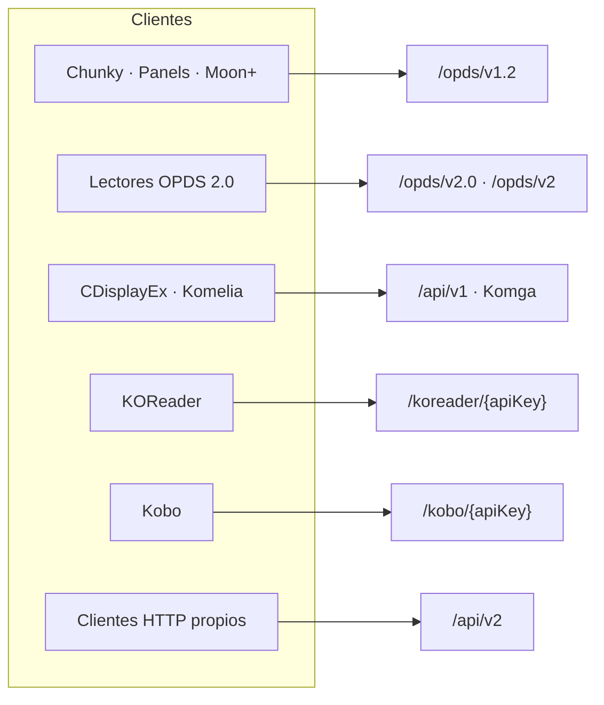

# 04 · APIs y protocolos

El backend expone siete superficies HTTP sobre el mismo catálogo. Cada una cuelga de su
propio prefijo.

Índice de la documentación por cliente: [clients/README.md](clients/README.md).



| Prefijo                                  | Protocolo                  | Formato                      | Detalle                                      |
| ---------------------------------------- | -------------------------- | ---------------------------- | -------------------------------------------- |
| `/opds/v1.2`, `/opds/{apiKey}/v1.2`      | OPDS 1.2                   | Atom XML                     | [clients/opds-v1.md](clients/opds-v1.md)     |
| `/opds/v2.0`, `/opds/v2` y variantes con `{apiKey}` | OPDS 2.0        | JSON (Readium / WebPub)      | [clients/opds-v2.md](clients/opds-v2.md)     |
| `/api/v1`                                | API compatible con Komga   | JSON                         | [clients/komga.md](clients/komga.md)         |
| `/api/v2`                                | API nativa                 | JSON, imágenes, ficheros     | [clients/native-api-v2.md](clients/native-api-v2.md) |
| `/koreader/{apiKey}`                     | KOReader Sync              | JSON                         | [clients/koreader.md](clients/koreader.md)   |
| `/kobo/{apiKey}`                         | Kobo Sync                  | JSON                         | [clients/kobo.md](clients/kobo.md)           |
| `/health`                                | Estado del servicio        | JSON                         | Esta página                                  |

Todas las rutas de las tablas siguientes son relativas a su prefijo. Si el servicio se publica
bajo un prefijo externo (`Gateway:PathBase`), ese prefijo precede a todas las rutas, incluidas
las de `/health`. Los enlaces que generan los feeds OPDS y Kobo llevan ese prefijo.

Cómo llega la identidad a cada superficie: [05-autenticacion-actual.md](05-autenticacion-actual.md).
Qué URL y credencial usa cada aplicación: [06-conexion-de-clientes.md](06-conexion-de-clientes.md).

## Convenciones comunes

- Los JSON usan nombres en `camelCase`, salvo los de los protocolos que fijan los suyos
  (Komga, OPDS 2.0, KOReader, Kobo).
- Los errores de la API nativa y de los filtros de permisos tienen la forma
  `{ "error": "<mensaje>" }`.
- Todo lo que devuelve un catálogo se filtra por usuario: bibliotecas excluidas y restricción
  de edad.
- Las descargas de ficheros admiten peticiones `Range`.
- La paginación de OPDS y de la API nativa empieza en `page=0`; la de Komga también.

## OPDS 1.2 — `/opds/v1.2`

El grupo se registra también como `/opds/{apiKey}/v1.2`, con las mismas rutas. Las respuestas
son Atom (`application/atom+xml;profile=opds-catalog`); `/search` devuelve el descriptor
OpenSearch (`application/opensearchdescription+xml`).

| Ruta                              | Parámetros de consulta          | Devuelve                              |
| --------------------------------- | ------------------------------- | ------------------------------------- |
| `GET /catalog`                    |                                 | Feed raíz de navegación               |
| `GET /search`                     |                                 | Descriptor OpenSearch                 |
| `GET /search/feed`                | `search`                        | Resultados de búsqueda                |
| `GET /keep-reading`               |                                 | Libros con lectura en curso           |
| `GET /libraries`                  | `search`                        | Bibliotecas                           |
| `GET /libraries/{id}`             | `page`                          | Series de una biblioteca              |
| `GET /series`                     | `search`, `page`                | Series                                |
| `GET /series/latest`              | `page`                          | Series recientes                      |
| `GET /series/{id}`                | `page`                          | Libros de una serie                   |
| `GET /books`                      | `search`, `page`                | Libros                                |
| `GET /books/latest`               | `page`                          | Libros recientes                      |
| `GET /books/{id}/thumbnail`       |                                 | Miniatura                             |
| `GET /books/{id}/pages/{page}`    | `zero_based` (defecto `true`), `cover` (defecto `false`) | Página como imagen |
| `GET /books/{id}/file`            |                                 | Fichero original                      |
| `GET /books/{id}/file/{filename}` |                                 | Igual; el nombre solo va en la URL    |

`404` si la biblioteca o la serie no existen o no son visibles.

## OPDS 2.0 — `/opds/v2.0`

El grupo se registra bajo cuatro prefijos con las mismas rutas: `/opds/v2.0`, `/opds/v2`,
`/opds/{apiKey}/v2.0` y `/opds/{apiKey}/v2`.

| Ruta                              | Parámetros          | Devuelve                                                           |
| --------------------------------- | ------------------- | ------------------------------------------------------------------ |
| `GET /auth`                       |                     | Authentication Document (`application/opds-authentication+json`)   |
| `GET /catalog`                    |                     | Feed raíz                                                          |
| `GET /search`                     | `query`             | Búsqueda                                                           |
| `GET /libraries`                  |                     | Bibliotecas                                                        |
| `GET /libraries/{id}`             | `page`              | Series de la biblioteca                                            |
| `GET /libraries/{id}/browse`      | `page`              | Alias de `libraries/{id}`                                          |
| `GET /series`                     | `page`              | Series                                                             |
| `GET /series/{id}`                | `page`              | Libros de la serie                                                 |
| `GET /books/browse`               | `page`              | Catálogo de libros                                                 |
| `GET /libraries/browse`           | `page`              | Alias de `books/browse`                                            |
| `GET /books/latest`               | `page`              | Libros (mismo handler que `books/browse`)                          |
| `GET /libraries/books/latest`     | `page`              | Alias de `books/latest`                                            |
| `GET /books/keep-reading`         |                     | Lectura en curso                                                   |
| `GET /libraries/keep-reading`     |                     | Alias de `books/keep-reading`                                      |
| `GET /books/{id}`                 |                     | Publicación (`application/opds-publication+json`); `404` si no existe |
| `GET /books/{id}/thumbnail`       |                     | Miniatura                                                          |
| `GET /books/{id}/pages/{page}`    | `zero_based` (defecto `true`) | Página como imagen                                       |
| `GET /books/{id}/progression`     |                     | Progreso `{ page, percentage, modified, device }`; `404` si no hay |
| `PUT /books/{id}/progression`     |                     | Guarda el progreso (mismo cuerpo); `200`, o `400` si no se pudo     |
| `GET /books/{id}/file`            |                     | Fichero original                                                   |

`GET /auth` es público: se sirve sin identidad (ver [05](05-autenticacion-actual.md#rutas-públicas)).
Declara los flujos `http://opds-spec.org/auth/basic` y `http://opds-spec.org/auth/local`,
cada uno con las etiquetas `login` y `password`.

## API compatible con Komga — `/api/v1`

Las respuestas paginadas tienen la forma de `Page<T>` de Spring: `content`, `totalElements`,
`totalPages`, `number`, `size`. `page` empieza en 0; `size` vale 20 por defecto y se limita a
1–100.

| Ruta                              | Método | Parámetros                    | Función                                  |
| --------------------------------- | ------ | ----------------------------- | ---------------------------------------- |
| `/libraries`                      | GET    |                               | Bibliotecas visibles                     |
| `/libraries/{id}`                 | GET    |                               | Una biblioteca                           |
| `/series`                         | GET    | `library_id`, `search`, `page`, `size` | Series                          |
| `/series/{id}`                    | GET    |                               | Una serie                                |
| `/series/{id}/books`              | GET    | `page`, `size`                | Libros de la serie                       |
| `/series/{id}/thumbnail`          | GET    |                               | Miniatura (la del primer libro)          |
| `/books`                          | GET    | `search`, `page`, `size`      | Libros                                   |
| `/books/latest`                   | GET    | `page`, `size`                | Libros recientes                         |
| `/books/{id}`                     | GET    |                               | Un libro                                 |
| `/books/{id}/pages`               | GET    |                               | Lista de páginas                         |
| `/books/{id}/pages/{pageNumber}`  | GET    |                               | Página como imagen (numeración desde 1)  |
| `/books/{id}/thumbnail`           | GET    |                               | Miniatura                                |
| `/books/{id}/file`                | GET    |                               | Fichero original                         |
| `/books/{id}/read-progress`       | PATCH  |                               | Cuerpo `{ "page": n, "completed": bool }`; `204`, o `400` si no se pudo |
| `/books/{id}/read-progress`       | DELETE |                               | Borra el progreso; `204`, o `404`        |
| `/claim`                          | GET    |                               | `{ "isClaimed": true }`                  |
| `/login/set-cookie`               | GET    |                               | `204` sin cuerpo                         |

Además, fuera del prefijo `/api/v1` pero en la misma superficie:

| Ruta                  | Método | Función                                                                                       |
| --------------------- | ------ | --------------------------------------------------------------------------------------------- |
| `/api/v2/users/me`    | GET    | Usuario actual en formato Komga: `id`, `email` (el nombre de usuario), `roles`, `sharedAllLibraries`, `sharedLibrariesIds`, `labelsAllow`, `labelsExclude`, `ageRestriction` |

`roles` siempre incluye `USER`; incluye `ADMIN` si el usuario es propietario del servidor o
trae el rol `admin`. `sharedAllLibraries` es `true` si el usuario no tiene bibliotecas
excluidas. `ageRestriction` es `{ age, restriction }` con `restriction` igual a `ALLOW_ONLY` o
`EXCLUDE`, o se omite si no hay restricción.

## API nativa — `/api/v2`

Todas las rutas requieren identidad. Los permisos que se indican en la columna **Permiso**
se explican en [05](05-autenticacion-actual.md#permisos); sin él, la respuesta es `403` con
`{ "error": ... }`.

### Sistema

| Ruta        | Método | Respuesta                                                              |
| ----------- | ------ | ---------------------------------------------------------------------- |
| `/ping`     | GET    | `"pong"`                                                               |
| `/health`   | GET    | `{ "status": "healthy" }`                                              |
| `/version`  | GET    | `{ "semver": "0.1.0", "rev": "<cadena fija>" }`                |
| `/claim`    | GET    | `{ "isClaimed": bool }`                                                |
| `/auth/me`  | GET    | `{ id, username, isServerOwner, ageRestriction }` del usuario resuelto |

### Catálogo y lectura

Las listas paginadas devuelven `{ data, total, page, pageSize, totalPages }`; `page` empieza
en 0 y `pageSize` vale 20 por defecto.

| Ruta                          | Método | Parámetros                         | Función                                              |
| ----------------------------- | ------ | ---------------------------------- | ---------------------------------------------------- |
| `/media`                      | GET    | `page`, `pageSize`, `newestFirst`  | Libros                                               |
| `/media/keep-reading`         | GET    |                                    | Lectura en curso                                     |
| `/media/{id}`                 | GET    |                                    | Un libro                                             |
| `/media/{id}/page/{page}`     | GET    |                                    | Una página; `Cache-Control: public, max-age=86400`   |
| `/media/{id}/thumbnail`       | GET    |                                    | Miniatura; `Cache-Control: public, max-age=86400`    |
| `/media/{id}/file`            | GET    |                                    | Fichero original                                     |
| `/media/{id}/progress`        | PUT    |                                    | Cuerpo `{ "page": n, "percentage"?: x, ... }`; `200 { "updated": true }` o `404` |
| `/series`                     | GET    | `libraryId`, `page`, `pageSize`    | Series                                               |
| `/series/{id}`                | GET    |                                    | Una serie                                            |
| `/series/{id}/media`          | GET    | `page`, `pageSize`                 | Libros de la serie                                   |
| `/series/{id}/thumbnail`      | GET    |                                    | Portada de la serie; `Cache-Control: public, max-age=86400` |
| `/epub/{id}/toc`              | GET    |                                    | Índice del EPUB                                      |
| `/epub/{id}/resource/{*path}` | GET    |                                    | Recurso interno del EPUB; `Cache-Control: public, max-age=86400` |
| `/libraries`                  | GET    |                                    | Bibliotecas visibles                                 |
| `/libraries/{id}`             | GET    |                                    | Una biblioteca                                       |
| `/libraries/{id}/missing`     | GET    |                                    | Medios cuyo fichero falta en disco                   |

### Gestión de bibliotecas y series

| Ruta                              | Método | Permiso          | Función                                                       |
| --------------------------------- | ------ | ---------------- | ------------------------------------------------------------- |
| `/libraries`                      | POST   | `ManageLibrary`  | Crea una biblioteca (`{ name, path, description?, emoji?, ... }`); `201`, o `400 { error }` |
| `/libraries/{id}`                 | PUT    | `ManageLibrary`  | Actualiza una biblioteca; `404` si no existe                  |
| `/libraries/{id}`                 | DELETE | `ManageLibrary`  | Borra la biblioteca; consulta `deleteFiles`; `204`            |
| `/libraries/{id}/purge-missing`   | POST   | `ManageLibrary`  | Quita del índice los medios ausentes; `{ "removed": n }`      |
| `/series/{id}`                    | PUT    | `ManageLibrary`  | Actualiza una serie                                           |
| `/series/{id}`                    | DELETE | `ManageLibrary`  | Borra la serie; consulta `deleteFiles`; `204`                 |
| `/series/{id}/thumbnail`          | PUT    | `ManageLibrary`  | Fija la portada desde un medio: `{ "mediaId": "..." }`        |
| `/series/{id}/thumbnail`          | POST   | `ManageLibrary`  | Sube la portada, `multipart/form-data` con una imagen JPG, PNG o WebP |
| `/series/{id}/thumbnail`          | DELETE | `ManageLibrary`  | Quita la portada personalizada; `204`                         |
| `/media/{id}`                     | DELETE | `ManageLibrary`  | Borra el medio; consulta `deleteFile`; `204`                  |

### Escaneo

| Ruta                           | Método | Permiso        | Función                                                          |
| ------------------------------ | ------ | -------------- | ---------------------------------------------------------------- |
| `/libraries/{id}/scan`         | POST   | `ScanLibrary`  | Encola un escaneo; `202`, o `404`                                |
| `/libraries/{id}/scan`         | GET    |                | Estado del escaneo; `204` si no hay ninguno                      |
| `/libraries/{id}/scan/stream`  | GET    |                | Server-Sent Events (`text/event-stream`): un evento `data:` con el estado por cada cambio, hasta que `finished` es `true`; línea `: ping` cada 20 s |
| `/libraries/scans`             | GET    |                | Escaneos activos                                                 |

El estado de escaneo tiene los campos `libraryId`, `phase`, `completedSeries`, `totalSeries`,
`currentSeries`, `completedMedia`, `totalMedia`, `pendingMedia`, `currentFile`, `readingFiles`,
`createdMedia`, `createdSeries`, `currentMedia`, `currentSeriesId`, `message`, `percentage`,
`elapsedSeconds`, `etaSeconds`, `finished`, `queued`.

### Subida de ficheros

**Multipart** — `POST /libraries/{id}/upload`, `multipart/form-data`. Admite el campo `subpath`
(en el formulario o como parámetro de consulta, que tiene prioridad) y uno o varios ficheros.
Requiere `FileUpload`, y `CreateFolder` si el subdirectorio no existe.

| Código | Causa                                                   |
| ------ | ------------------------------------------------------- |
| `200`  | Subida aceptada                                         |
| `400`  | Cuerpo no multipart, falta el `boundary` u otro error de validación |
| `403`  | Subidas desactivadas o falta de permiso                 |
| `404`  | La biblioteca no existe                                 |
| `413`  | Un fichero supera `MaxFileUploadSize`                   |

**Reanudable (tus 1.0.0)** — `/api/v2/files`. Extensiones `creation` y `termination`.

| Petición              | Detalle                                                                                          |
| --------------------- | ------------------------------------------------------------------------------------------------ |
| `OPTIONS /files`      | `204` con `Tus-Version`, `Tus-Extension`, `Tus-Max-Size`                                         |
| `POST /files`         | Cabeceras `Upload-Length` (> 0) y `Upload-Metadata` con `libraryId` y `filename` obligatorios y `subpath` opcional (valores en Base64). `201` con `Location: /files/{id}` (ruta relativa a `/api/v2`). Requiere `FileUpload`, y `CreateFolder` si el subdirectorio no existe |
| `HEAD /files/{id}`    | Devuelve `Upload-Offset` y `Upload-Length`; `404` si la sesión no existe                          |
| `PATCH /files/{id}`   | `Content-Type: application/offset+octet-stream` y `Upload-Offset`. `204` con el nuevo `Upload-Offset`; `409` con el `Upload-Offset` actual si no coincide; `415` si el tipo es otro; `403` sin `FileUpload`. Al completar los bytes el fichero se coloca en la biblioteca y se encola un escaneo |
| `DELETE /files/{id}`  | Descarta la sesión; `204`                                                                        |

Las respuestas llevan `Tus-Resumable: 1.0.0`.

### Carpetas y papelera

Todas requieren `ManageLibrary`.

| Ruta                               | Método | Parámetros          | Función                                                            |
| ---------------------------------- | ------ | ------------------- | ------------------------------------------------------------------ |
| `/filesystem/roots`                | GET    |                     | Raíces de bibliotecas configuradas (`path`, `name`, `mounted`)     |
| `/filesystem/browse`               | GET    | `path`              | Subcarpetas de una ruta (máx. 1000, sin las ocultas)               |
| `/filesystem/disk`                 | GET    | `path`              | Espacio total y libre                                              |
| `/filesystem/preview`              | GET    | `path`, `pattern`   | Series que detectaría un escaneo (`pattern`: `SeriesBased` o `CollectionBased`) |
| `/filesystem/folder`               | POST   |                     | Crea una carpeta                                                   |
| `/filesystem/index`                | GET    |                     | Estado del índice de carpetas                                      |
| `/filesystem/index`                | POST   |                     | Lanza un repaso del índice; `202`, o `409` si ya hay uno           |
| `/filesystem/search`               | GET    | `q`, `limit`        | Busca en el índice de carpetas                                     |
| `/filesystem/deletion`             | GET    | `path`              | Qué se borraría (ficheros, bytes, subcarpetas)                     |
| `/filesystem/entry`                | DELETE | `path`              | Mueve la ruta a la papelera                                        |
| `/trash`                           | GET    |                     | Entradas de la papelera                                            |
| `/trash/{id}/restore`              | POST   |                     | Restaura una entrada; `204`, o `400`                               |
| `/trash/{id}`                      | DELETE | `id`                | Elimina la entrada definitivamente; `204`, o `404`                 |

Las rutas fuera de las raíces configuradas responden `403`.

### Metadatos externos

| Ruta                                          | Método | Permiso         | Función                                                              |
| --------------------------------------------- | ------ | --------------- | -------------------------------------------------------------------- |
| `/metadata/status`                            | GET    |                 | Estado del catálogo externo y de su ingesta                          |
| `/metadata/download`                          | POST   | `ManageLibrary` | Inicia la descarga del volcado; `202`, o `409` si hay una en curso   |
| `/metadata/import`                            | POST   | `ManageLibrary` | Sube un volcado (`.zst`, `.tar.gz`, `.tgz`) por `multipart/form-data` |
| `/metadata/import/init`                       | POST   | `ManageLibrary` | Abre una subida por trozos: `{ fileName, totalBytes }` → `{ uploadId, chunkSize }` |
| `/metadata/import/chunk`                      | POST   | `ManageLibrary` | Parámetros `uploadId` y `offset`; cuerpo binario del trozo → `{ offset }`; `409 { error, currentOffset }` si el offset no coincide |
| `/metadata/import/complete`                   | POST   | `ManageLibrary` | `{ uploadId, fileName }`; inicia la ingesta                          |
| `/metadata/cover`                             | GET    |                 | Parámetro `url`; proxy de portada; `Cache-Control: public, max-age=604800` |
| `/metadata/series/{seriesId}/candidates`      | GET    | `ManageLibrary` | Candidatos de coincidencia (`limit`, defecto 10)                     |
| `/metadata/series/{seriesId}/match/{mangaBakaId}` | PUT | `ManageLibrary` | Aplica la coincidencia: `{ "matched": true }`                        |
| `/metadata/series/{seriesId}/match`           | DELETE | `ManageLibrary` | Quita la coincidencia; `204`                                         |

### Preferencias de usuario

| Ruta                          | Método | Función                                                                             |
| ----------------------------- | ------ | ----------------------------------------------------------------------------------- |
| `/users/{id}/epub-profiles`   | GET    | Perfiles de dispositivo EPUB del usuario                                            |
| `/users/{id}/epub-profiles`   | PUT    | Sustituye los perfiles; `{ "updated": true, "count": n, "affectedBooks": n }`        |

`{id}` admite el valor literal `me`. Un usuario solo accede a los suyos, salvo el propietario
del servidor o quien trae el rol `admin`; en otro caso, `403`.

## KOReader Sync — `/koreader/{apiKey}`

Todas las rutas del grupo exigen el permiso `AccessKoreaderSync` (`403` sin él). `{apiKey}` es
un segmento de ruta que el servicio no valida (ver [05](05-autenticacion-actual.md)).

| Ruta                          | Método | Respuesta                                                                    |
| ----------------------------- | ------ | ---------------------------------------------------------------------------- |
| `/users/auth`                 | GET    | `{ "authorized": "OK" }`                                                     |
| `/users/create`               | GET    | `{ "authorized": "OK" }`                                                     |
| `/syncs/progress/{document}`  | GET    | `{ document, progress?, percentage?, device?, device_id?, timestamp? }`; solo `document` si no hay progreso |
| `/syncs/progress`             | PUT    | Cuerpo `{ document, progress, percentage, device?, device_id? }`; `200`, `400` o `404` |

`{document}` y `document` son el hash de documento de KOReader (MD5), no el id del servidor.

## Kobo Sync — `/kobo/{apiKey}`

Todas las rutas del grupo exigen el permiso `AccessKoboSync` (`403` sin él).

| Ruta                                                                            | Método | Función                                                  |
| ------------------------------------------------------------------------------- | ------ | -------------------------------------------------------- |
| `/v1/initialization`                                                            | GET    | Objeto con el diccionario de recursos del dispositivo (`image_host`, `image_url_template`, `image_url_quality_template`, `account_page`, `assets`, `book_detail_page`, `categories`, `configuration_data`); cabecera `x-kobo-apitoken: e30=` |
| `/v1/library/sync`                                                              | GET    | Sincronización incremental, 100 elementos por respuesta  |
| `/v1/library/{bookId}/metadata`                                                 | GET    | Metadatos de un libro; `404` si no existe                |
| `/v1/books/{bookId}/thumbnail/{width}/{height}/{isGreyscale}/image.jpg`         | GET    | Miniatura                                                |
| `/v1/books/{bookId}/thumbnail/{width}/{height}/{quality}/{isGreyscale}/image.jpg` | GET  | Miniatura, variante con calidad                          |
| `/v1/books/{bookId}/file/epub`                                                  | GET    | Descarga del EPUB                                        |

La sincronización usa la cabecera `x-kobo-synctoken`: el cliente envía la que recibió; la
respuesta trae la nueva y, si quedan elementos, `x-kobo-sync: continue`. Las URL de portada
de `/v1/initialization` se construyen con el esquema, el host y el prefijo de
la petición, y llevan el `{apiKey}` de la ruta.

## `/health`

`GET /health` está fuera de los prefijos que exigen identidad y se sirve sin ella.

```json
{ "status": "healthy", "service": "DiarSpeicher", "version": "1.0.0", "database": "SQLite (WAL)" }
```
