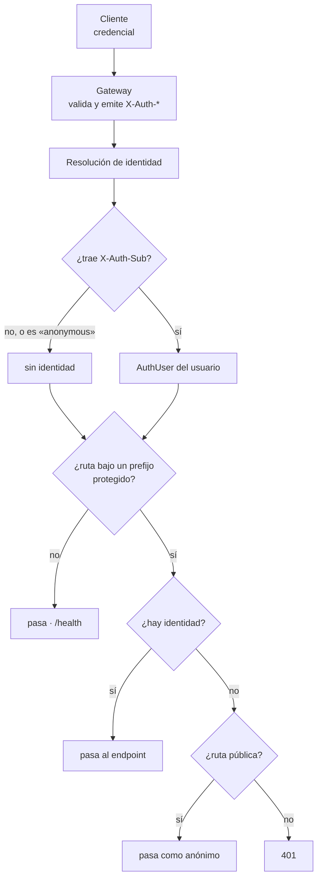

# 05 · Autenticación

El servicio no valida credenciales. La identidad llega ya resuelta en cabeceras `X-Auth-*`
que inyecta el Gateway, y el servicio la aplica a cada petición. Un cliente nunca envía esas
cabeceras: envía una credencial al Gateway y este las produce.

Documentación por mecanismo y por cliente: [clients/README.md](clients/README.md).
Rutas de cada protocolo: [04-apis-y-protocolos.md](04-apis-y-protocolos.md).
Receta por aplicación: [06-conexion-de-clientes.md](06-conexion-de-clientes.md).



## Mecanismos de credencial

El Gateway acepta estas credenciales y las traduce a la misma identidad. Las prueba en este
orden y gana la primera que valida:

| Orden | Mecanismo                    | Dónde va la credencial                                                    | Rutas donde aplica                        |
| ----- | ---------------------------- | ------------------------------------------------------------------------- | ----------------------------------------- |
| 1     | Clave de API en la URL       | Segmento de ruta: `/opds/{apiKey}/...`, `/koreader/{apiKey}/...`, `/kobo/{apiKey}/...` | `/opds`, `/koreader`, `/kobo`  |
| 2     | Clave de API en cabecera, o HTTP Basic | `X-Auth-Key: <clave>`, o `Authorization: Basic base64(usuario:contraseña)` | Cualquier ruta                  |
| 3     | Sesión                       | Cookie `diarspeicher_session`, o `Authorization: Bearer <jwt>`            | Cualquier ruta                            |

- En HTTP Basic, el valor del campo contraseña se prueba primero como clave de API; si no es
  una clave válida se prueba como contraseña de la cuenta. Si la contraseña va vacía, se
  prueba el campo usuario como clave.
- La clave de API solo funciona si la cuenta tiene el protocolo `api_key` habilitado
  (valor por defecto). La contraseña de la cuenta en Basic exige `basic_password`, que se
  habilita por usuario.
- La sesión se obtiene con `POST /plugins/diarspeicher/auth/login`, cuerpo
  `{ "username": "...", "password": "..." }`. Responde `200` con
  `{ "token", "expires_at", "user": { id, username, role, is_admin } }` y fija la cookie
  `diarspeicher_session` (`HttpOnly`, `Secure`, `SameSite=Lax`, `Path=/`) con vigencia de 7
  días. El mismo `token` sirve como `Bearer`. Credenciales incorrectas: `401`.
- Una sesión no transporta restricción de edad.
- El Gateway blanquea `X-Auth-Key` antes de reenviar la petición.

Cuando ninguna credencial valida, el Gateway responde `401` sin llegar al servicio. Si
`header_basic_key` figura entre los autenticadores del montaje, esa respuesta incluye
`WWW-Authenticate: Basic realm="..."`; si no, no lo incluye.

## Cabeceras que recibe el servicio

| Cabecera       | Se traduce a                                                                          |
| -------------- | ------------------------------------------------------------------------------------- |
| `X-Auth-Sub`   | Identificador del usuario. Sin ella, o con el valor `anonymous`, no hay identidad     |
| `X-Auth-User`  | Nombre de usuario; si falta se usa el valor de `X-Auth-Sub`                           |
| `X-Auth-Role`  | Roles, separados por coma                                                             |
| `X-Auth-Perms` | Permisos, separados por coma                                                          |
| `X-Auth-Age`   | Restricción de edad (entero); si no es un entero, se usa la guardada localmente       |

Cuando hay varias cabeceras con el mismo nombre se usa la última. `X-Auth-App` y `X-Auth-Jti`
se ignoran.

Con una cabecera `X-Auth-Sub` válida, el servicio:

- Mantiene un registro local del usuario, creado en su primera petición y con el nombre
  actualizado cuando cambia. Si el identificador es nuevo pero ya existe un usuario con ese
  nombre, ese registro pasa a usar el identificador nuevo conservando su progreso y sus
  exclusiones.
- Marca como **propietario del servidor** al primer usuario que ve la instancia. La
  propiedad no se lee de ninguna cabecera.
- Carga del registro local las bibliotecas excluidas del usuario. La restricción de edad
  viene de `X-Auth-Age` si es un entero, y si no, del registro local.

El servicio no comprueba el origen de las cabeceras `X-Auth-*`: confía en ellas. Por eso solo
debe ser alcanzable a través del Gateway.

## Prefijos protegidos

Exigen identidad las rutas que empiezan por:

`/opds` · `/api/v1` · `/api/v2` · `/koreader` · `/kobo`

Sin identidad responden `401` con el cuerpo:

```json
{ "error": "Identity not resolved by the gateway" }
```

Cualquier otra ruta se sirve sin identidad. La única que existe es `/health`.

## Rutas públicas

En una ruta pública el Gateway valida con `200` y cabeceras `X-Auth-*` vacías; el servicio
atiende la petición como anónima en lugar de rechazarla. El usuario anónimo no tiene
identificador, roles ni permisos, no es propietario y tiene restricción de edad activa.

Rutas públicas por defecto (con o sin prefijo `/opds/{apiKey}`):

| Ruta                                          |
| --------------------------------------------- |
| `/opds/v2.0/auth`, `/opds/{apiKey}/v2.0/auth` |
| `/opds/v2/auth`, `/opds/{apiKey}/v2/auth`     |

Se pueden sustituir con `Gateway:PublicPaths`. Cada patrón se compara por segmentos, sin
distinguir mayúsculas; `*` equivale a exactamente un segmento y `**` al resto de la ruta. Un
patrón sin `**` exige coincidencia exacta. La ruta se compara sin el prefijo
`Gateway:PathBase`.

## Clave de API en la ruta

En `/opds/{apiKey}/v1.2|v2.0|v2`, `/koreader/{apiKey}` y `/kobo/{apiKey}` el servicio lee el
segmento `{apiKey}` solo para repetirlo en los enlaces que genera, de modo que el cliente siga
navegando bajo la misma URL. No lo valida. No lee la clave de `X-Auth-Key` ni de ningún
parámetro de consulta.

## Permisos

`X-Auth-Perms` es una lista de nombres. El comodín `*` equivale a todos, y el propietario del
servidor los tiene todos sin necesidad de listarlos.

| Permiso              | Qué abre                                                                              |
| -------------------- | ------------------------------------------------------------------------------------- |
| `FileUpload`         | `POST /api/v2/libraries/{id}/upload`, `POST` y `PATCH /api/v2/files`                  |
| `CreateFolder`       | Los mismos, cuando el subdirectorio de destino no existe                              |
| `ManageLibrary`      | Crear, editar y borrar bibliotecas, series y medios; portadas de serie; `/api/v2/filesystem`, `/api/v2/trash` y las operaciones de `/api/v2/metadata` que modifican datos |
| `ScanLibrary`        | `POST /api/v2/libraries/{id}/scan`                                                    |
| `AccessKoreaderSync` | Todo `/koreader/{apiKey}`                                                             |
| `AccessKoboSync`     | Todo `/kobo/{apiKey}`                                                                 |

Sin el permiso, la respuesta es `403` con `{ "error": "..." }`, salvo `PATCH /api/v2/files/{id}`,
que responde `403` sin cuerpo.

El rol `admin` o ser propietario permite además acceder a los perfiles EPUB de otro usuario
(`/api/v2/users/{id}/epub-profiles`) y se refleja como `ADMIN` en `GET /api/v2/users/me`.

## Resumen por protocolo

| Prefijo                 | Credencial habitual                                  | Permiso adicional      |
| ----------------------- | ---------------------------------------------------- | ---------------------- |
| `/opds/v1.2`            | Clave en la URL, o Basic                             |                        |
| `/opds/v2.0`, `/opds/v2`| Clave en la URL, Basic, o sesión; `/auth` es público |                        |
| `/api/v1`, `/api/v2`    | `X-Auth-Key`, Basic, o sesión (cookie o Bearer)      | Según la ruta          |
| `/koreader/{apiKey}`    | Clave en la URL                                      | `AccessKoreaderSync`   |
| `/kobo/{apiKey}`        | Clave en la URL                                      | `AccessKoboSync`       |
